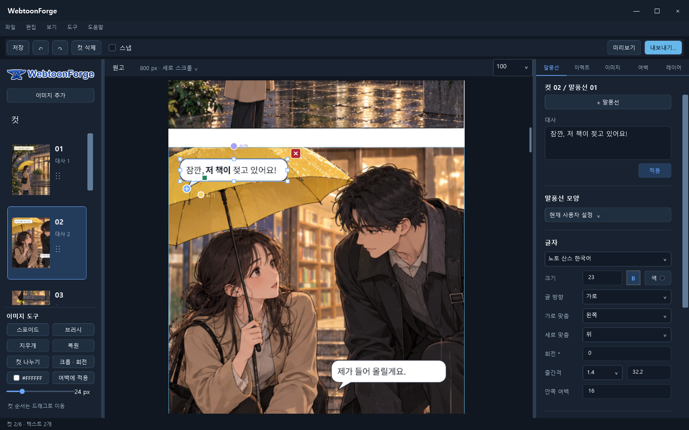

# WebtoonForge

이미 준비한 컷 이미지를 배치하고 말풍선·이펙트·여백을 편집해 세로 스크롤 웹툰 원고를 만드는 Windows 앱입니다.

## 다운로드 및 실행

1. [v0.5-preview.3 Windows x64 포터블 ZIP](https://github.com/sogwangsang/WebtoonForge/releases/download/v0.5-preview.3/WebtoonForge-v0.5-preview.3-win-x64-portable-singlefile.zip)을 받습니다.
2. 쓰기 권한이 있는 새 폴더에 ZIP 전체를 풉니다.
3. `WebtoonForge.exe`를 실행합니다. 별도 설치나 .NET SDK 설치는 필요 없습니다.
4. **이미지로 시작** 또는 **도움말 → 웹툰 예제 열기**로 시작하세요. 기존 원고는 **프로젝트 열기**에서 선택합니다.

[한국어 사용 안내](https://github.com/sogwangsang/WebtoonForge/releases/download/v0.5-preview.3/USER_GUIDE_KO.md) · [변경 내역](https://github.com/sogwangsang/WebtoonForge/releases/download/v0.5-preview.3/CHANGELOG.md) · [릴리스 및 체크섬](https://github.com/sogwangsang/WebtoonForge/releases/tag/v0.5-preview.3)

## 주요 기능

- 컷 이미지 가져오기, 순서 변경, 크롭·회전, 긴 이미지에서 컷 나누기
- 원고 위 말풍선 더블클릭 편집과 레이어 번호 표시
- 말풍선·이펙트 복사와 커서 위치 붙여넣기, 최근 편집 설정 기억
- 벡터 이펙트 가로·세로 크기, 선의 빈 공간·굵기 조절 및 감정 이펙트 회전
- 여백 프리셋, 스포이드, 브러시, 대사 가리기와 복원
- 프로젝트 저장·다시 열기, 모바일 폭 미리보기, PNG·JPG·WebP 내보내기

## 프리뷰 안내

내보내기 기본값은 **고화질 원본 보관 · PNG**입니다. 스마트 분할을 끄면 크기 제한 내에서 한 장으로 저장됩니다. ZIP에는 단일 실행 파일, 사용 안내, 변경 내역, 예제와 라이선스가 들어 있습니다. 실행 파일은 코드 서명되지 않았으며 별도의 클린 Windows 환경은 아직 검증하지 않았습니다.
